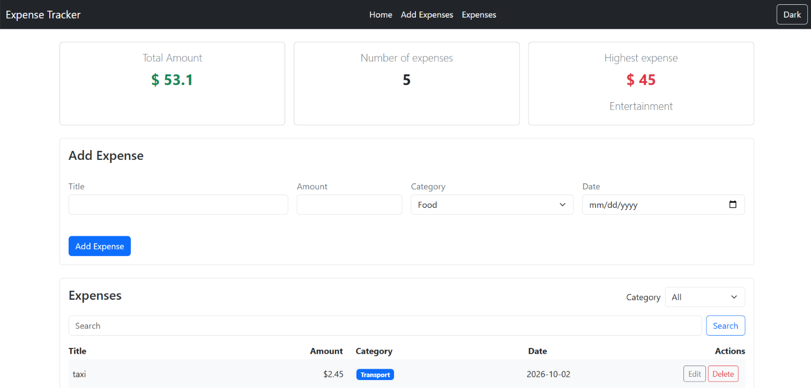
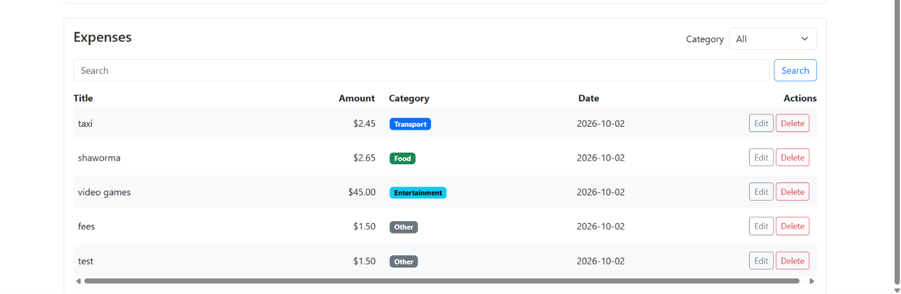

# Expense Tracker

A full-stack Expense Tracker application that allows users to add, edit, delete, search, and filter expenses. The application uses a Node.js and Express backend with PostgreSQL for data storage, and a responsive frontend built with HTML, CSS, JavaScript, and Bootstrap.


## How to run


**Backend**


1. Open the project in VS Code.

2. Open PostgreSQL / pgAdmin and create a database named: `tracker_expense`

3. Open the `schema.sql` file and run the SQL commands inside the `tracker_expense` database.

4. Open the terminal inside the `backend` folder:

```bash
cd backend

5. Install the required packages:
npm install

6. Create a .env file inside the backend folder:
DB_HOST=localhost
DB_PORT=5432
DB_USER=postgres
DB_PASSWORD=YOUR_PASSWORD
DB_NAME=tracker_expense

7. Start the backend server:

```bash
node server.js

The backend API will run on:
http://localhost:3000


**Frontend**

1.. Make sure the backend server is running.

2.. Open the frontend project in VS Code.

3.. Open index.html using Live Server.

4.. The Expense Tracker application will open in your browser.


# Features

- [✓] Add an expense (with validation)
- [✓] Delete an expense
- [✓] Edit an expense
- [✓] Filter by category
- [✓] Summary cards (total, count, highest)
- [✓] Data is saved in a PostgreSQL database
- [✓] Search expenses by title
- [✓] Dark mode
- [✓] Responsive design
- [✓] Skeleton loading
- [✓] REST API
- [✓] Error handling

## Screenshots




## What was the hardest part?

The hardest part was connecting the frontend, backend, and PostgreSQL database together and making sure that adding, editing, and deleting 

expenses worked correctly. I also had some issues with CORS and asynchronous requests. I solved these problems by testing the API using 

Thunder Client, checking the server responses, and using `async/await` with `try/catch` to handle requests and errors.>
